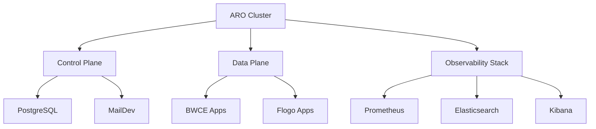
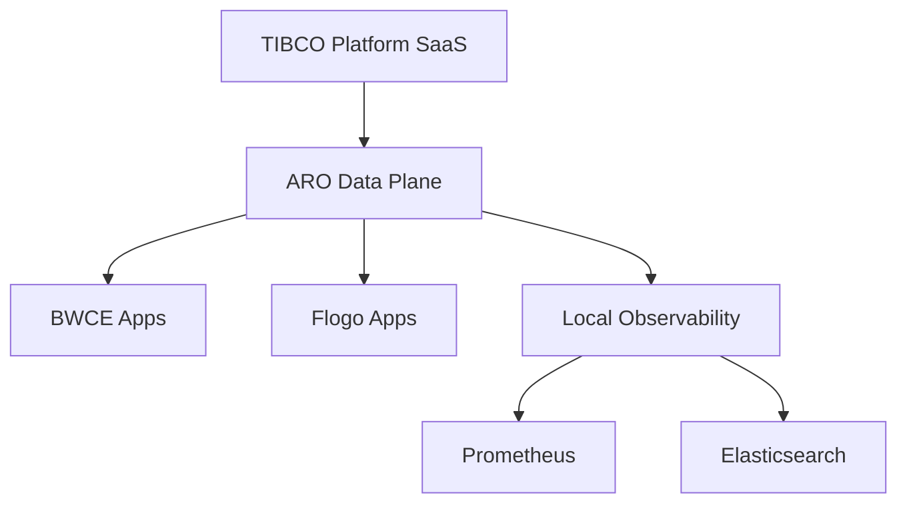
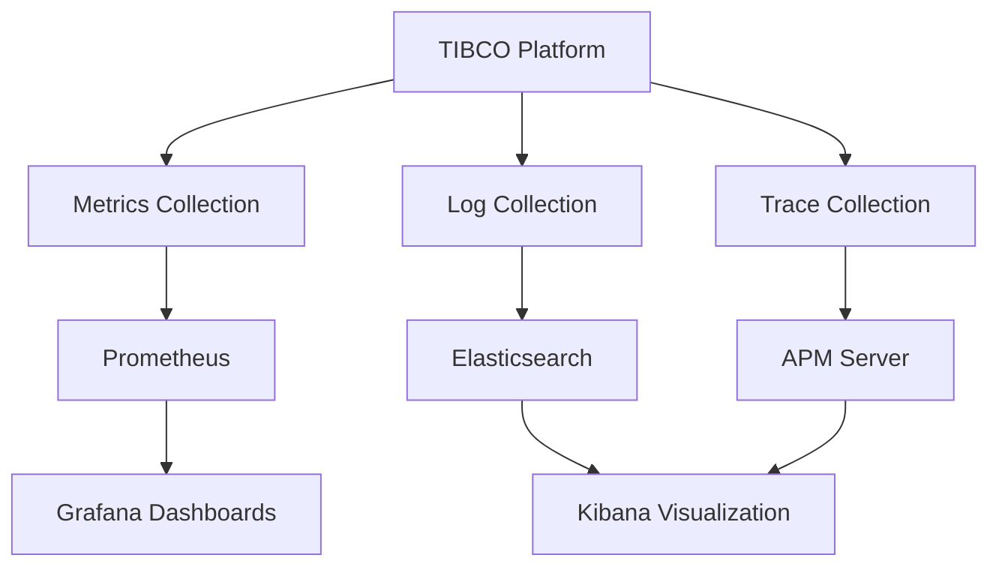

# TIBCO Platform on Azure Red Hat OpenShift (ARO) Workshop

> **Current Release:** [v1.21.0](./releases/v1.21.0) | **TIBCO Platform CP Version:** 1.21.0
> 📋 **Release History:** See `releases` folder for all versions  
> 🔄 **Upgrading from 1.18.0?** Upgrade to 1.19.0, then 1.20.0, then 1.21.0 ([1.21.0 upgrade guidance](./releases/v1.21.0#upgrade-from-1200))

This repository provides comprehensive guides and resources for deploying **TIBCO Platform** on **Azure Red Hat OpenShift (ARO)** clusters. It covers multiple deployment scenarios from basic ARO cluster setup to full Control Plane and Data Plane deployments with observability.

## 🎯 Version Selection

**⚠️ Important:** TIBCO Platform 1.21.0 adds per-Data-Plane hybrid connectivity and custom ingress/Gateway API support, Kubernetes Secret authentication for custom registries, Native Control Tower (Preview), self-hosted MCP Hub, Maintenance Mode, TESSA write-operation guardrails, and EMS MCP. Upgrades go one minor version at a time. Choose the appropriate documentation for your deployment:

### 🌟 Version 1.21.0 (Current - Recommended for New Deployments)
- ✅ **Per-Data-Plane hybrid connectivity**: enable or disable connectivity per Data Plane and register an existing ingress or Gateway API controller
- ✅ **Custom registry Secret**: use a Kubernetes Secret instead of username/password during cluster registration; create it in each relevant Data Plane namespace
- ✅ **Native Control Tower (Preview)**: manage supported Linux x86_64 hosts without Kubernetes or containers
- ✅ **Self-hosted MCP Hub**: install `tibco-cp-mcp-hub` in the Control Plane namespace
- ✅ **Maintenance Mode and TESSA guardrails**: block user writes during maintenance; TESSA writes remain disabled until enabled by a subscription owner
- ✅ **Capability updates**: BW5/BW6 management, EMS provisioning wizard, EMS MCP (one per Data Plane), process diagrams and BW5 Control Tower API
- 📘 [Quick Reference (v1.21)](./howto/v1.21/QUICK-REFERENCE)
- 📋 [Release Notes (v1.21.0)](./releases/v1.21.0)

### 📦 Version 1.20.0 (Previous Release)
- ✅ **Control Plane Rollback**: `helm rollback` to the previous release, including the database schema when `manageDbSchema` is `true`
- ✅ **Chart Values**: new `global.tibco.disabledInfraCapabilities` (default `[MFTADAPTER]`); `otel-collector.enabled` default is `false` again; `createDeprecatedPolicies` gone since 1.19.0
- ✅ **OTLP Custom Headers**: OTLP exporters and query services accept custom headers
- ✅ **Flogo Build Jobs**: dedicated Kubernetes Jobs with their own CPU, memory, queue, and timeout settings
- ✅ **Developer Hub MCP Catalog**: register and browse MCP servers as Backstage entities
- ✅ **MCP Hub (Preview)**: TIBCO Operated Control Plane only; MCP Gateway runtime chart `tp-mcp-gateway`
- ✅ **OpenShift Ready**: no SCC changes from 1.18.0; OpenShift Router remains the primary ingress
- 📘 [Setup Overlay Guide: CP + DP (v1.20)](./howto/v1.20/how-to-cp-and-dp-aro-setup-guide)
- 📘 [Quick Reference (v1.20)](./howto/v1.20/QUICK-REFERENCE)
- 📋 [Release Notes (v1.20.0)](./releases/v1.20.0)

### 📦 Version 1.19.0 (Previous Release - Mandatory Upgrade Hop from 1.18.0)
- ✅ **TESSA (Preview)**: natural-language assistant, TIBCO Operated Control Plane US region only
- ✅ **Infra MCP Server**: read-only `kubectl`/`helm` diagnostics capability per Data Plane (RBAC from `dp-configure-namespace` 1.19.10)
- ✅ **ActiveSpaces Capability**: data grid and vector store on Kubernetes Data Planes
- ✅ **PromQL Cards and Jaeger v2**: PromQL observability cards; Jaeger chart 4.8.2 (old traces show as red dots)
- ✅ **Gateway API Fix**: `hybrid-proxy` HTTPRoute renders `/infra/tunnel` itself (PCP-21362)
- ✅ **Removed Value**: `global.tibco.networkPolicy.createDeprecatedPolicies` must be deleted before upgrading
- 📘 [Setup Overlay Guide: CP + DP (v1.19)](./howto/v1.19/how-to-cp-and-dp-aro-setup-guide)
- 📘 [Quick Reference (v1.19)](./howto/v1.19/QUICK-REFERENCE)
- 📋 [Release Notes (v1.19.0)](./releases/v1.19.0)

### 📦 Version 1.18.0 (Previous Release)
- ✅ **Gateway API Controller**: Support for Control Tower data planes; BW5/BW6/Flogo can use `Other` Gateway API type
- ✅ **Namespace-Level RBAC**: Application Manager and Application Viewer scoped by capability and namespace
- ✅ **Console-Managed Email**: Email server configuration moves from Helm values to Platform Console UI
- ✅ **Alert Audit Trail**: System health and rule performance events recorded in the UI
- ✅ **Developer Hub Self-Service Flows**: Reusable platform automation with customizable templates
- 📘 [Setup Overlay Guide: CP + DP (v1.18)](./howto/v1.18/how-to-cp-and-dp-aro-setup-guide)
- 📘 [Quick Reference (v1.18)](./howto/v1.18/QUICK-REFERENCE)
- 📋 [Release Notes (v1.18.0)](./releases/v1.18.0)

### 📦 Version 1.17.0 (Previous Release)
- ✅ **Webhook Receiver for Alerts**: Integrate alerts with external systems via JSON webhook
- ✅ **OpenSearch Observability**: Use OpenSearch for Jaeger traces and service logs
- ✅ **BW6 Lifecycle Management**: Full Agent, Domain, AppSpace, AppNode, App management in UI
- ✅ **Fluentbit Customization**: Custom log forwarding config for BW5/BW6 containers and Flogo
- ✅ **Flogo Recipe Customization**: YAML editor for capability recipes; 3 new connectors
- ✅ **BW5 Hawk REST API**: 31 Hawk methods exposed on port 8090 in BW5CE
- 📘 [Setup Guide: CP + DP](./howto/how-to-cp-and-dp-openshift-aro-aks-setup-guide)
- 📘 [Quick Reference (v1.17)](./howto/v1.17/QUICK-REFERENCE)
- 📋 [Release Notes (v1.17.0)](./releases/v1.17.0)

### 📦 Version 1.16.0 (Previous Release)
- ✅ **License Management**: Automated 90/30/7 day expiration alerts
- ✅ **BW6 AI Plugin 6.0.0**: RAG capabilities for AI-powered integrations
- ✅ **Enhanced Monitoring**: Improved BW5 monitoring and observability
- ✅ **Flogo Improvements**: Init and sidecar container support
- 📘 [Setup Guide: CP + DP (v1.16)](./howto/how-to-cp-and-dp-openshift-aro-aks-setup-guide)
- 📘 [Quick Reference (v1.16)](./howto/v1.16/QUICK-REFERENCE)
- 📋 [Release Notes (v1.16.0)](./releases/v1.16.0)

### 📦 Version 1.15.0 (Previous Release)
- ✅ **Latest Features**: Enhanced security, improved network policies, OpenShift Router support
- ✅ **New Capabilities**: Event processing, updated Developer Hub 1.15.14
- 📘 [Setup Guide: CP + DP (v1.15)](./howto/v1.15/how-to-cp-and-dp-openshift-aro-aks-setup-guide)
- 📘 [Setup Guide: DP Only  (v1.15)](./howto/v1.15/how-to-dp-openshift-aro-aks-setup-guide)
- 📋 [Release Notes (v1.15.0)](./releases/v1.15.0)

### 📦 Version 1.14.0 (Archived)
- 📘 [Setup Guide: CP + DP (v1.14)](./howto/v1.14/how-to-cp-and-dp-openshift-aro-aks-setup-guide)
- 📘 [Setup Guide: DP Only (v1.14)](./howto/v1.14/how-to-dp-openshift-aro-aks-setup-guide)
- 📋 [Release Notes (v1.14.0)](./releases/v1.14.0)

### 🔄 Upgrading Between Versions
- **From v1.20.0 → v1.21.0**: Direct upgrade supported by the 1.21.0 assistant (`scripts/1.21.0/upgrade.sh`); it requires a deployed 1.20.0 Control Plane. See [1.21.0 Release Notes](./releases/v1.21.0#upgrade-from-1200)
- **From v1.19.0 → v1.20.0**: Direct upgrade supported (`scripts/1.20.0/upgrade.sh`). See [1.20.0 Release Notes](./releases/v1.20.0#upgrade-path-from-v1190)
- **From v1.18.0 → v1.19.0**: Direct upgrade supported (`scripts/1.19.0/upgrade.sh`); remove `createDeprecatedPolicies` first. See [1.19.0 Release Notes](./releases/v1.19.0#upgrade-path-from-v1180)
- **From v1.18.0 → v1.21.0**: Not supported directly. Upgrade to 1.19.0, then 1.20.0, then 1.21.0 (or follow the official sequential upgrade guidance in `tp-helm-charts`)
- **From v1.17.0 → v1.18.0**: Direct upgrade supported. See [1.18.0 Release Notes](./releases/v1.18.0#upgrade-path-from-v1170)
- **From v1.16.0 → v1.17.0**: Direct upgrade supported. See [1.17.0 Release Notes](./releases/v1.17.0#upgrade-path)
- **From v1.15.0 → v1.16.0**: Direct upgrade supported. See [1.16.0 Release Notes](./releases/v1.16.0#upgrade-path)
- **From v1.14.0 → v1.15.0**: TIBCO provides an automated upgrade script. See [1.15.0 Release Notes](./releases/v1.15.0#upgrade-path)

---

## 🎯 What This Repository Helps You Setup

### 1. **TIBCO Platform Control Plane (CP) + Data Plane (DP) on Same ARO Cluster**
Deploy a complete TIBCO Platform environment with both Control Plane and Data Plane on a single ARO cluster for evaluation and workshop purposes.

### 2. **TIBCO Platform SaaS Control Plane + ARO Data Plane**
Connect an ARO-based Data Plane to an existing TIBCO Platform SaaS Control Plane for hybrid cloud deployments.

### 3. **Observability Setup for CP/DP**
Configure comprehensive monitoring and logging using Prometheus and Elastic Stack (ECK) for both Control Plane and Data Plane deployments.

## 📚 Documentation Structure

### 🏗️ Version-Specific Setup Guides

#### Version 1.21.0 (Current Release)
- **[Quick Reference Guide (v1.21)](./howto/v1.21/QUICK-REFERENCE)** — upgrade order, chart versions, ARO SCC checks, and 1.21 operational changes
- **[Release Notes (v1.21.0)](./releases/v1.21.0)** — release features, chart artifacts, requirements, upgrade assistant, and known issues

#### Version 1.20.0 (Previous Release)
**[📖 Setup Overlay Guide: CP + DP (v1.20)](./howto/v1.20/how-to-cp-and-dp-aro-setup-guide)**
- 🎯 **Scope**: 1.20.0-specific changes to apply on top of the shared ARO baseline guide
- 🔧 **New Features**: Control Plane rollback, values changes (`disabledInfraCapabilities`, `otel-collector` default), fixed Gateway API route, OTLP custom headers, Flogo build Jobs, MCP notes
- ⏱️ **Duration**: 30-60 minutes (overlay on top of shared guide)

**[📖 Quick Reference Guide (v1.20)](./howto/v1.20/QUICK-REFERENCE)**
- 🎯 **Scope**: Quick commands and reference for TIBCO Platform 1.20.0 on ARO
- 🔧 **New Features**: values checks, rollback commands, Gateway API checks, SCC verification, MCP RBAC checks
- ⏱️ **Duration**: Reference guide (instant lookup)

**[📖 Documentation Summary (v1.20)](./howto/v1.20/DOCUMENTATION-SUMMARY)**
- 🎯 **Scope**: Overview of v1.19.0 and v1.20.0 updates and changes for ARO
- 🔧 **Features**: ARO-specific update details, three-release component version comparison, updated files list, validation checklist
- ⏱️ **Duration**: 10-15 minutes read

#### Version 1.19.0 (Upgrade Hop)
**[📖 Setup Overlay Guide: CP + DP (v1.19)](./howto/v1.19/how-to-cp-and-dp-aro-setup-guide)**
- 🎯 **Scope**: 1.19.0-specific changes, applied between 1.18.0 and 1.20.0
- 🔧 **Features**: `createDeprecatedPolicies` removal, `otel-collector` default, Jaeger v2, PCP-23331 workaround, Infra MCP Server, fixed Gateway API route
- ⏱️ **Duration**: 30-60 minutes (overlay on top of shared guide)

**[📖 Quick Reference Guide (v1.19)](./howto/v1.19/QUICK-REFERENCE)** and **[📖 Documentation Summary (v1.19)](./howto/v1.19/DOCUMENTATION-SUMMARY)**

#### Version 1.18.0 (Previous Release)
**[📖 Setup Overlay Guide: CP + DP (v1.18)](./howto/v1.18/how-to-cp-and-dp-aro-setup-guide)** — Gateway API controller, namespace-level RBAC, Console-managed email, Alert Audit Trail, Developer Hub self-service flows

**[📖 Quick Reference Guide (v1.18)](./howto/v1.18/QUICK-REFERENCE)** and **[📖 Documentation Summary (v1.18)](./howto/v1.18/DOCUMENTATION-SUMMARY)**

#### Version 1.17.0 (Previous Release)
**[📖 Quick Reference Guide (v1.17)](./howto/v1.17/QUICK-REFERENCE)** and **[📖 Documentation Summary (v1.17)](./howto/v1.17/DOCUMENTATION-SUMMARY)**

**[📖 How to Set Up ARO Cluster with Control Plane and Data Plane](./howto/how-to-cp-and-dp-openshift-aro-aks-setup-guide)**
- 🎯 **Scope**: Complete TIBCO Platform CP + DP deployment on ARO (shared baseline, includes hardened SCC configuration; use the [1.21 release notes](./releases/v1.21.0) and Control Plane-generated commands for the current charts)
- 🔧 **Features**: Azure environment preparation, PostgreSQL, DNS, certificates, SCC hardening, CP + DP deployment
- ⏱️ **Duration**: 3-4 hours

#### Version 1.16.0 (Previous Release)
**[📖 Quick Reference Guide (v1.16)](./howto/v1.16/QUICK-REFERENCE)** and **[📖 Documentation Summary (v1.16)](./howto/v1.16/DOCUMENTATION-SUMMARY)**

#### Version 1.15.0 (Previous Release)
**[📖 How to Set Up ARO Cluster with Control Plane and Data Plane (v1.15)](./howto/v1.15/how-to-cp-and-dp-openshift-aro-aks-setup-guide)** and **[📖 How to Set Up ARO Cluster for Data Plane Only (v1.15)](./howto/v1.15/how-to-dp-openshift-aro-aks-setup-guide)**

#### Version 1.14.0 (Previous Release)
**[📖 How to Set Up ARO Cluster with Control Plane and Data Plane (v1.14)](./howto/v1.14/how-to-cp-and-dp-openshift-aro-aks-setup-guide)** and **[📖 How to Set Up ARO Cluster for Data Plane Only (v1.14)](./howto/v1.14/how-to-dp-openshift-aro-aks-setup-guide)**

### 🔍 Shared Documentation (Compatible with All Versions)

#### [🗺️ Topology Options Guide](./howto/topology-options)
**Control Plane and Data Plane topology patterns for all environments**
- 🎯 **Scope**: SaaS CP, self-hosted CP with co-located or separate DP clusters, Control Tower for on-premises TIBCO, DTAP organization, subscription strategies, API Gateway integration, and deployment flavors
- 📋 **Use Case**: Architecture planning, environment design, and enterprise topology decisions before deployment
- ⏱️ **Duration**: Reference guide (15-30 minutes read)

### 🔍 Observability Setup

#### [📖 How to Install Observability for Data Plane](./howto/how-to-dp-openshift-observability)
**Complete observability stack setup for TIBCO Platform**
- 🎯 **Scope**: Elastic ECK + Prometheus + Grafana for monitoring and logging
- 🔧 **Features**:
  - Elastic Cloud on Kubernetes (ECK) operator installation
  - Elasticsearch, Kibana, and APM Server configuration
  - Prometheus and Grafana deployment
  - TIBCO Platform metrics and logs integration
  - Performance monitoring and alerting
- 📋 **Use Case**: Production monitoring, troubleshooting, performance analysis
- ⏱️ **Duration**: 1-2 hours

### 🔧 Post-Deployment Capability Configuration

#### [📖 How to Upload Driver Supplements to BW6 Capability](./howto/how-to-upload-bw6-driver-supplements)
**Supplementing Oracle and EMS drivers for TIBCO BusinessWorks 6 (Containers)**
- 🎯 **Scope**: Upload Oracle Database and EMS client library drivers to BW6 capability
- 🔧 **Features**:
  - Oracle Database driver preparation and packaging
  - EMS client libraries preparation and packaging
  - Step-by-step upload process via Control Plane UI
  - Troubleshooting common upload issues
  - Verification and testing procedures
- 📋 **Use Case**: Oracle database integration, EMS messaging integration, driver supplementation
- ⏱️ **Duration**: 15-30 minutes per driver
- 🎁 **Benefits**: Enables Oracle and EMS connectivity for BW6 applications

### 🌐 DNS and Networking

#### [📖 How to Add DNS Records for ARO Routes](./howto/how-to-add-dns-records-aro-azure)
**DNS management for TIBCO Platform services**
- 🎯 **Scope**: Azure DNS configuration for ARO ingress routing
- 🔧 **Features**:
  - Wildcard DNS strategy for TIBCO Platform
  - Azure CLI and Portal methods for DNS record creation
  - External DNS automation setup
  - Certificate and DNS alignment best practices
- 📋 **Use Case**: Custom domain setup, SSL certificate management, service discovery
- ⏱️ **Duration**: 30-60 minutes

### 📋 Prerequisites and Planning

#### [📖 Customer Prerequisites Checklist](./howto/prerequisites-checklist-for-customer)
**Comprehensive pre-installation requirements checklist**
- 🎯 **Scope**: Complete prerequisites for Control Plane and Data Plane installation
- 🔧 **Features**:
  - Kubernetes/OpenShift cluster requirements; verify the exact OpenShift version against the official 1.21 system requirements and ARO availability
  - PostgreSQL 16 database specifications
  - Storage, networking, and DNS requirements
  - Certificate and security requirements
  - Ingress controller compatibility matrix
  - Browser requirements and supported versions
  - Control Tower Data Plane specifications
  - Naming conventions and restrictions (PostgreSQL identifier rules)
- 📋 **Use Case**: Pre-installation planning, customer readiness assessment, infrastructure preparation
- ⏱️ **Preparation Time**: 3-5 business days
- 🎁 **Benefits**: Reduces deployment delays, ensures all requirements met before installation day

#### [📖 Firewall Requirements and Network Connectivity](./docs/firewall-requirements-aro)
**Complete firewall and network requirements for TIBCO Platform deployment on ARO**
- 🎯 **Scope**: All external endpoints required for TIBCO Platform and OpenShift on ARO
- 🔧 **Features**:
  - Container registry endpoints (TIBCO JFrog, Red Hat registries, Docker Hub, GitHub, etc.)
  - Helm chart repository URLs
  - Red Hat/OpenShift service endpoints (api.openshift.com, console.redhat.com, quay.io)
  - Azure cloud provider endpoints (ARM, Azure AD, storage, monitoring)
  - Go module proxy for Flogo applications (proxy.golang.org)
  - Network Security Group (NSG) rules for Azure
  - Azure Firewall application rules (copy-paste ready)
  - OpenShift cluster-wide proxy configuration
  - TIBCO Platform proxy configuration (UI and Helm)
  - DNS requirements and connectivity testing commands
  - ARO-specific considerations and Red Hat SRE requirements
- 📋 **Use Case**: Enterprise deployments, air-gapped environments, firewall rule requests, proxy configuration
- ⏱️ **Review Time**: 30-60 minutes
- 🎁 **Benefits**: Streamlines firewall approval process, prevents connectivity issues, ensures ARO cluster health

**Related Documentation**:
- [Firewall Requirements for AKS](https://tibco-bnl.github.io/workshop-tp-aks/docs/firewall-requirements-aks.html) - Azure Kubernetes Service specific requirements
- [Firewall Requirements for EKS](https://tibco-bnl.github.io/workshop-tp-aks/docs/firewall-requirements-eks.html) - Amazon EKS specific requirements with AWS endpoints and VPC configuration

---

#### [📄 Environment Variables Script](./howto/aks-aro-openshift-env-variables.sh)
**Centralized environment configuration**
- 🎯 **Scope**: All required environment variables for TIBCO Platform deployment (`CP_TIBCO_CP_BASE_VERSION=1.21.0`)
- 🔧 **Features**:
  - Azure and ARO cluster variables
  - TIBCO Platform specific configurations
  - DNS and certificate settings
  - Container registry and Helm chart configurations
- 📋 **Use Case**: Quick environment setup, variable standardization, deployment automation

### 🔄 Image Synchronization

#### [📖 How to Push TIBCO Platform Images to a Custom Container Registry](./howto/how-to-sync-images)
**Mirroring images to a private or air-gapped registry**
- 🎯 **Scope**: Pre-installation image mirroring for air-gapped, firewalled, or private-registry ARO deployments
- 🔧 **Features**:
  - Official TIBCO `sync-images.sh` script usage and configuration
  - `skopeo copy` — bit-perfect mirroring for Podman / OpenShift environments (recommended)
  - `docker buildx imagetools` — Docker environment approach
  - `skopeo dir://` — air-gapped physical data transfer
  - `oc mirror` — declarative bulk mirroring for OpenShift
  - Why `podman push` / `docker push` corrupt BusinessWorks plugin images (GZIP BTYPE corruption)
  - Image integrity verification and remediation runbook
- 📋 **Use Case**: Air-gapped deployments, corporate firewalled environments, enterprise private registry policies
- ⏱️ **Duration**: 30-60 minutes (plus image transfer time)

### 🔧 Troubleshooting

#### [📖 Troubleshooting Guide](./howto/troubleshooting)
**Documented deployment issues and verified solutions**
- 🎯 **Scope**: Real issues encountered during TIBCO Platform deployments on ARO, with root cause analysis and step-by-step fixes
- 🔧 **Issues Covered**:
  - **SCC Permission Error**: Pods forbidden on ARO — granting `tp-scc` to service accounts before chart deployment
  - **Cross-Namespace Crash Loops**: O11y / Flogo Provisioner DNS lookup failures due to wrong namespace suffix in Data Plane values
  - **Control Plane Proxy Registration Failure**: `BackoffLimitExceeded` in air-gapped environments — missing CA trust stores and image pull secrets
  - **BusinessWorks Plugin Extraction Crash**: `tar: invalid tar header` caused by image layer re-compression when pushing to a custom registry — use `docker buildx imagetools`, `skopeo copy`, or `oc mirror` instead of standard push
- 📋 **Use Case**: Diagnosing and resolving deployment failures, air-gapped/custom registry environments, OpenShift SCC issues
- ⏱️ **Per-issue resolution**: 15–60 minutes

If an upgrade to 1.20.0 fails, use the Control Plane rollback procedure in the [v1.20 overlay](./howto/v1.20/how-to-cp-and-dp-aro-setup-guide#control-plane-rollback).

## 🎯 Deployment Scenarios

### Scenario 1: Complete TIBCO Platform on ARO

**Use this for:**
- ✅ Workshop and evaluation environments
- ✅ Complete standalone TIBCO Platform deployments
- ✅ Development and testing environments
- ✅ Proof of concepts and demos

**Follow:** [Complete Setup Guide](./howto/how-to-cp-and-dp-openshift-aro-aks-setup-guide) plus the [v1.20 overlay](./howto/v1.20/how-to-cp-and-dp-aro-setup-guide)

### Scenario 2: ARO Data Plane Connected to SaaS Control Plane

**Use this for:**
- ✅ Hybrid cloud deployments
- ✅ Edge computing scenarios
- ✅ Regional data plane deployments
- ✅ Connecting to existing SaaS Control Plane

**Follow:** [Data Plane Only Guide](./howto/how-to-dp-openshift-aro-aks-setup-guide)

### Scenario 3: Enhanced Observability Setup

**Use this for:**
- ✅ Production monitoring and alerting
- ✅ Performance analysis and optimization
- ✅ Troubleshooting and diagnostics
- ✅ Compliance and audit requirements

**Follow:** [Observability Setup Guide](./howto/how-to-dp-openshift-observability)

## 🛠️ Architecture Overview

### Control Plane Components
- **Platform Base (`tibco-cp-base`)**: Unified chart with core platform services, operators, IDM, orchestrator, router, hybrid proxy, and web server
- **Integration Capabilities**: BWCE and Flogo integration services
- **Observability**: Built-in monitoring and alerting (Jaeger v2 since 1.19.0)

### Data Plane Components
- **Core Infrastructure**: Runtime environment for applications (`dp-configure-namespace`, `dp-core-infrastructure`)
- **Capability Provisioning**: BWCE, Flogo, EMS, ActiveSpaces, Developer Hub, Hawk, Infra MCP Server
- **Observability Integration**: Metrics, logs, and traces collection
- **Hybrid Connectivity**: Secure connection to Control Plane

### Shared Infrastructure
- **ARO Cluster**: Azure Red Hat OpenShift cluster
- **Storage Classes**: Azure Files and Disk storage integration (Azure Disk for Developer Hub PostgreSQL)
- **Ingress Controller**: OpenShift router with wildcard domain support (Gateway API optional)
- **DNS Management**: Azure DNS with wildcard entries
- **Certificate Management**: Let's Encrypt integration

## 🔗 Additional Resources

### TIBCO Platform Documentation
- [TIBCO Platform Control Plane 1.21.0 Documentation](https://docs.tibco.com/pub/platform-cp/1.21.0/doc/html/Default.htm)
- [TIBCO Platform Control Plane 1.19.0 Documentation](https://docs.tibco.com/pub/platform-cp/1.19.0/doc/html/Default.htm)
- [TIBCO Platform Official Documentation (latest)](https://docs.tibco.com/pub/platform-cp/latest/doc/html/Default.htm)
- [TIBCO Platform Proxy Configuration](https://docs.tibco.com/pub/platform-cp/1.21.0/doc/html/UserGuide/updating-proxy-configuration.htm)
- [TIBCO tp-helm-charts repository](https://github.com/TIBCOSoftware/tp-helm-charts) — [ARO workshop assets](https://github.com/TIBCOSoftware/tp-helm-charts/tree/main/docs/workshop/aro%20(Azure%20Red%20Hat%20OpenShift)) and [upgrade scripts](https://github.com/TIBCOSoftware/tp-helm-charts/tree/main/scripts)

### Cloud Provider Documentation
- [Azure Red Hat OpenShift Documentation](https://docs.microsoft.com/en-us/azure/openshift/)
- [OpenShift Container Platform Documentation](https://docs.openshift.com/)
- [OpenShift Cluster-Wide Proxy Configuration](https://docs.openshift.com/container-platform/latest/networking/enable-cluster-wide-proxy.html)

### Related Workshop Repositories
- [TIBCO Platform on AKS Workshop](https://github.com/tibco-bnl/workshop-tp-aks) - Azure Kubernetes Service deployment guides
- [TIBCO Platform on EKS Workshop](https://github.com/tibco-bnl/workshop-tp-eks) - Amazon EKS deployment guides
  - [AKS Firewall Requirements](https://tibco-bnl.github.io/workshop-tp-aks/docs/firewall-requirements-aks.html)
  - [EKS Firewall Requirements](https://tibco-bnl.github.io/workshop-tp-aks/docs/firewall-requirements-eks.html)

### Observability and Monitoring
- [Elastic Cloud on Kubernetes (ECK)](https://www.elastic.co/guide/en/cloud-on-k8s/current/index.html)
- [Prometheus Operator Documentation](https://prometheus-operator.dev/)

## 🤝 Contributing

We welcome contributions to improve these guides and add new deployment scenarios. Please:

1. Fork the repository
2. Create a feature branch
3. Make your improvements
4. Test the documentation with actual deployments
5. Submit a pull request with detailed description

## 📄 License

This project is licensed under the terms specified in the LICENSE file.

---

> **Note**: This repository contains actual steps and configurations used in real deployments. All examples use production-like configurations but should be adapted for your specific environment and security requirements.

**Last updated:** September 21, 2026
